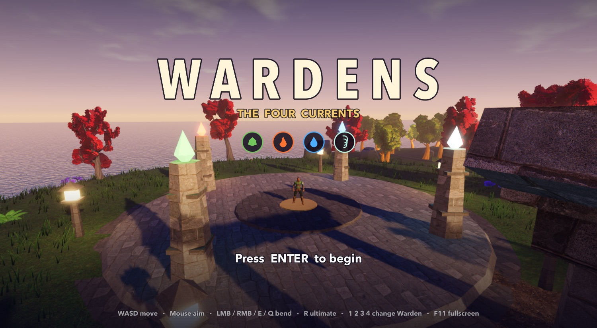
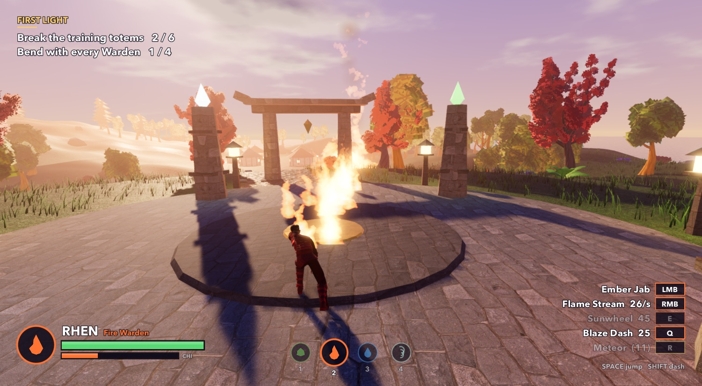
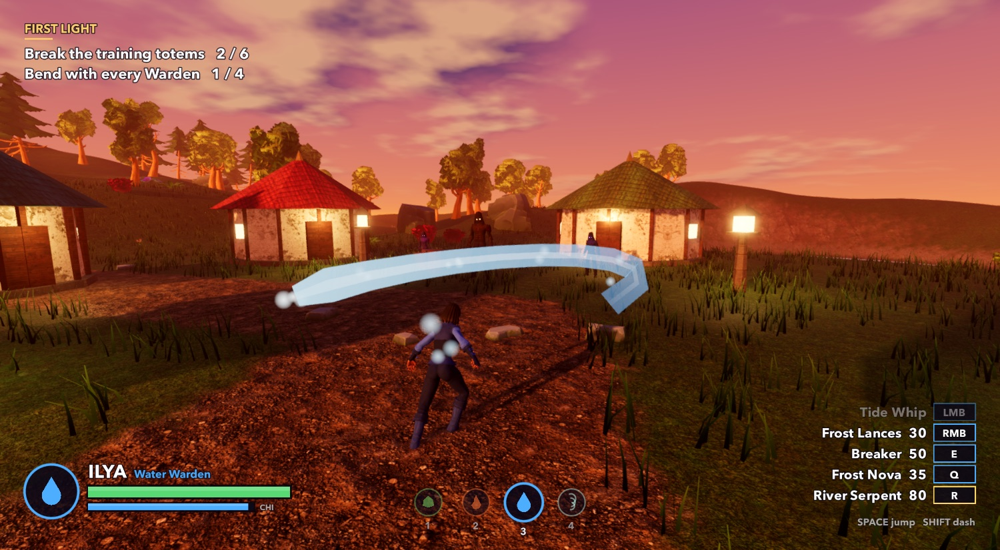
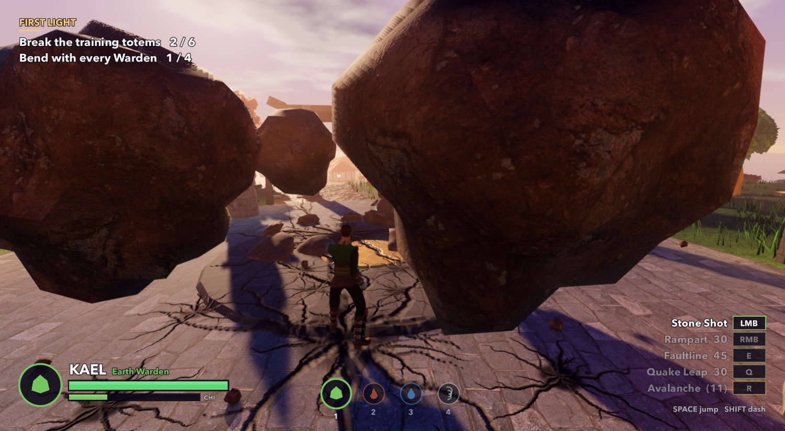
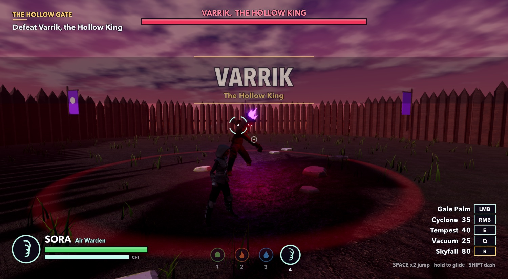

# WARDENS — The Four Currents

An original 3D elemental martial-arts adventure built in Godot 4, where almost everything — the world, the characters, the models and the sound — is generated from code.



## What it is

You play four Wardens of Aerath and swap between them at any moment, mid-fight. Each one bends a different element and has five moves: a light attack, a heavy attack, a special, a quick move and an ultimate.

| Warden | Element | Moves |
| --- | --- | --- |
| Kael | Earth | Stone Shot · Rampart · Faultline · Quake Leap · Avalanche |
| Rhen | Fire | Ember Jab · Flame Stream · Sunwheel · Blaze Dash · Meteor |
| Ilya | Water | Tide Whip · Frost Lances · Breaker · Frost Nova · River Serpent |
| Sora | Air | Gale Palm · Cyclone · Tempest · Vacuum · Skyfall |

Chapter One is a three-mission story — *First Light*, *Smoke over Mirren* and *The Hollow Gate* — that ends in a boss fight against Varrik, the Hollow King, and then opens up into free roam.

| | |
| --- | --- |
|  |  |
|  |  |

## Engineering highlights

- **No hand-built scenes.** `scenes/main.tscn` is a single empty node. The terrain, shrine, village, fort, lighting, HUD and every enemy are constructed at runtime by the scripts in `scripts/`.
- **Characters assembled at runtime.** `scripts/puppet.gd` grafts a base body, an outfit and hair onto one shared 65-bone skeleton and drives it with an `AnimationTree`. A bone-weight mask in `shaders/character.gdshader` hides the parts of the body that the outfit covers, so there is no clipping and no per-character mesh editing.
- **Procedural asset pipeline.** `blender/make_assets.py` generates the game's props, structures and enemies as `.glb` files from a Blender script, and `blender/make_sfx.py` synthesises every sound effect and the music loop with NumPy — no samples. Regenerating all assets is two commands.
- **Eleven custom shaders** for terrain blending, water, grass, sky, flame, toon shading and outlines.
- **The game tests itself.** `scripts/autopilot.gd` can play every move and capture screenshots (`--shots`), run the whole story start to finish (`--story`), or benchmark each rendering feature in turn (`--bench`).
- **Tuned for a fanless laptop.** The target machine is an M3 MacBook Air: about 55 fps in the heaviest view. Bounced lighting (SDFGI) costs roughly 10 fps there, so it is off by default and toggled with F10.

## Controls

| Input | Action |
| --- | --- |
| WASD | Move |
| Mouse | Aim |
| LMB / RMB / E / Q | Light / heavy / special / quick move |
| R | Ultimate |
| 1 2 3 4 | Change Warden |
| Space / Shift | Jump / dash |
| F11 / F10 | Fullscreen / bounced lighting |

## Run it

Requires [Godot 4.7](https://godotengine.org/) or newer.

```bash
git clone https://github.com/devhmez/wardens.git
cd wardens
godot --headless --path . --import   # first run only: imports the assets
godot --path .
```

On macOS with Godot installed through Homebrew you can also double-click `Play Wardens.command`.

Self-tests:

```bash
godot --path . -- --shots   # play every move, save screenshots to _shots/
godot --path . -- --story   # play all three missions (this overwrites your save)
godot --path . -- --bench   # frame-rate breakdown per rendering feature
```

To regenerate the generated models and sounds (needs Blender, whose bundled Python includes NumPy):

```bash
/Applications/Blender.app/Contents/MacOS/Blender --background --python blender/make_assets.py
/Applications/Blender.app/Contents/MacOS/Blender --background --python blender/make_sfx.py
godot --headless --path . --import
```

## Project structure

```
scripts/    game logic in GDScript: world, player, enemies, the four bending styles, missions, HUD, FX
shaders/    custom Godot shaders
blender/    Python generators for models and sound effects
assets/     generated models and sounds, plus the CC0 packs listed below
scenes/     the single entry scene
```

## Status

Playable: Chapter One is complete from the title screen to the boss and free roam. Built and tested on macOS (Apple Silicon); Windows is the next target.

## Credits

The world, story, characters and names are original. Character bodies, outfits, animations and foliage come from [Quaternius](https://quaternius.com/) packs (Universal Animation Library, Universal Base Characters, Modular Character Outfits – Fantasy, Stylized Nature MegaKit), and surface textures from [Poly Haven](https://polyhaven.com/). Both are released under CC0.

Built by [Hamza Dellai](https://github.com/devhmez).
